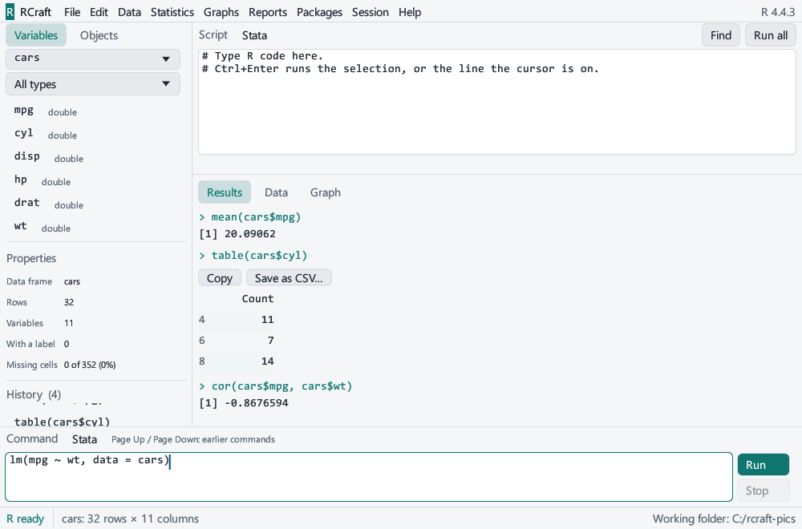

# The Command window

Type R at the Command line and press Enter to run it. Shift+Enter starts a new line without running. What you type and what R printed go into Results. A long script is better kept in the Script editor above Results, where Ctrl+Enter runs the selection, or the line the cursor is on.

## History

Everything you have run is listed in History on the left. Click an entry to put it back in the Command line. At the Command line, the Up and Down arrows walk back and forward through your earlier commands. Page Up and Page Down do the same.

## Tab completion

Press Tab to complete the word before the cursor. R itself answers, so it completes function names, objects, the columns of your data and file names. When several words fit, the choices are shown above the line; keep typing and press Tab again.

## Help from the Command window

These open the Help window and run nothing in R:

- `?mean`, `help(mean)` or `help mean`: the help page for a function.
- `??regression` or `help search regression`: a search of the help pages of the installed packages.
- `help rcraft`: this manual.

F1 asks for help on the word at the end of the line, and opens the search if there is none.

## Package commands

A few short commands do what the [Packages](packages) window does: `rc search panel data`, `rc describe fixest`, `rc install fixest`, `rc installed`, `rc update` and `rc remove`. They never run by themselves: an install, update or remove opens the same list with its yes button.

## Stata mode

The **Stata** switch on the Command and Script panes turns on Stata mode. Then you type Stata, RCraft translates it into R, and runs the R. In Results each line shows as Stata shows it, with the R it became under it and notes about anything that differs. Tab completes Stata commands, the variables of the data in memory, and file names. The Up and Down arrows recall the Stata you typed, not the R.

A command RCraft cannot translate is marked, not guessed. Help > **Stata and R: what differs** says where R's results differ from Stata's. File > **Run do-file** runs a whole do-file the same way.
