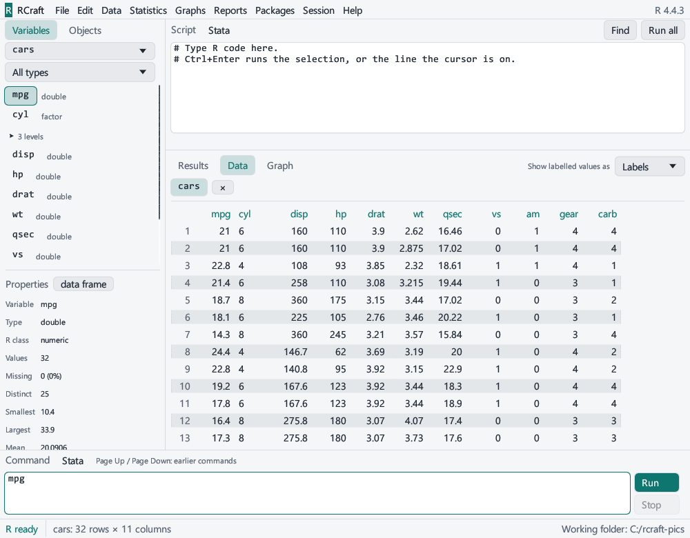

# The Data tab and Properties

The Data tab shows a data frame's rows, and the left side of the window says what is in it: the Variables and Objects tabs, and Properties under them.

## The Data tab

Choose **Data** beside Results. Each data frame you have shown gets a tab of its own above the grid; click one to show it again. The × beside it closes the tab, and the data frame stays in R. A tab goes by itself when its data frame is removed from R.

- The grid shows the row numbers on the left and the variables' names on top. Hold the mouse over a name for the variable's type and label.
- Numbers and dates sit on the right of their column, text on the left. Missing values show as `NA`, in grey.
- Only the rows and columns in view are drawn, so a data frame of millions of rows scrolls as easily as a small one.
- **Show labelled values as** chooses what a variable with value labels shows: its **Labels** (the default), its **Values**, or **Both**.

The Data tab is for looking. To change the data, use the [Data menu](data-dialogs), or type R in [the Command window](command-window); the grid shows the change as soon as R has made it.

## Variables

The box at the top of the Variables tab chooses the data frame to work on; the Data, Statistics and Graphs menus all use it. The box under it lists only one type of variable: numbers, text, factors, dates and times, logical, or those with labels.

Each line gives a variable's name and type, how many values are missing, and its label. Hold the mouse over a name for its R class, label and value labels. Click it to put the name in the Command line and show the variable in Properties.

A factor has a line under it saying how many levels it has. Open it for each level and how many rows have it, in the factor's own order: the first is the reference level, the one a model compares the others with. Click a level to put it, in quotes, in the Command line.

Under the list, a **Conversion report** says, when there is something to say, what came over from R as it was, what is shown as text only, and what was dropped.

## Objects

The Objects tab lists everything in R's workspace, with its class, and the rows and columns of a data frame. Click a data frame to show it; click anything else to put its name in the Command line. Right-click for more: rename, remove or save an object, and a fitted model's own menu (see [the Statistics menu](statistics-dialogs)).

## Properties

Properties, under Variables, describes the data frame shown, or the variable you last clicked:

- **For the data frame**: its name, rows, variables, how many have a label, and the missing cells (how many, of how many, and the share).
- **For a variable**: its name and label, its type and R class, how many values and how many missing, how many distinct values, the smallest, largest and mean of a number, and the levels of a factor or the value labels (the first six, and how many more).

The **data frame** button beside the title goes back to the data frame's properties. Properties are worked out from the table the window already has, so they ask R nothing.
