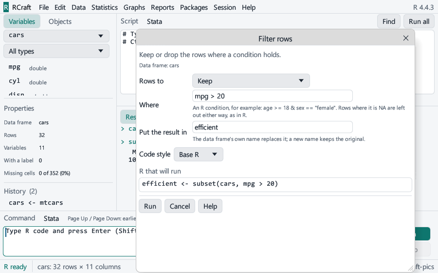

# The Data menu

The Data menu changes the data frame shown in Variables: its variables, its rows, or its shape. Choose the data frame in the box at the top of the Variables tab first. Until one is loaded, the entries are greyed out.

## How a Data dialog works

Every dialog has the same parts, top to bottom:

- A line saying what it does, and the data frame it works on.
- The choices. A choice that is missing or wrong says so under it in orange, and Run stays greyed out until it is put right.
- **Put the result in**: the data frame's own name (the default) replaces it; a new name keeps the original and makes a new data frame, which is then shown.
- **Code style**, in the dialogs that have one: **Base R**, which needs no package, or **Tidyverse (dplyr)**, which needs the dplyr package. The dialog says so, and offers to install it.
- **R that will run**: the code itself, shown once every choice is made.
- **Run**, **Cancel** and **Help**. Help opens the dialog's own page, with an example and links to R's help for the functions it uses.

The code runs in R as if you had typed it. It shows in Results and in History, and goes into the session's script, so it can be saved and run again.

## Variables and rows

- **New variable**: a variable worked out from the others. The value is an R expression using the other variables, for example `weight / height^2`. A name that is taken is replaced.
- **Filter rows**: keep, or drop, the rows where a condition holds, for example `age >= 18 & sex == "female"`. Rows where the condition is missing are left out either way, as in R.
- **Sort rows**: put the rows in order by up to three variables, each going up or down. Missing values go last.
- **Rename variable**: give a variable a new name.
- **Variable label**: a longer description of a variable, shown in Variables and in output.
- **Value labels**: say what the codes of a variable mean, as `1 = Low; 2 = Medium; 3 = High`. The values themselves do not change.
- **Labelled to factor**: turn a variable with value labels into a factor whose levels are the labels. A value with no label becomes missing.
- **Recode**: change some values into others with rules such as `1, 2 = Low; 3 to 5 = High; NA = 0`. The first rule that fits a value is used, and values no rule mentions are kept as they are or made missing, as you choose. The variable's label is kept.
- **Convert type**: make a variable a number, text or a factor. Text that is not a number becomes missing, and R warns that it did.

Recode, Convert type and the entries of the Factor, Text and Date menus can put their answer in a new variable instead of changing the old one.

## Factor

- **Reference level**: make one level of a factor the first. Models compare the other levels with it.
- **Combine levels**: merge levels into new ones. Levels you do not mention stay as they are.
- **Reorder levels**: put the levels in the order you want; tables and graphs follow it.

## Text

- **Text case and spaces**: tidy the spaces and capital letters of a text variable.
- **Find and replace text**: replace every occurrence of some text inside the values. You can ask for the text to be read as a pattern (a regular expression), and for capital letters to be ignored.
- **Extract part of text**: keep some of the characters of each value, counted from the left, starting at 1.

## Date

- **Text to date**: turn text that spells dates into real dates, choosing how the text is written. Values that do not fit become missing, and R says how many.
- **Date part**: a new variable with the year, month, day or weekday of a date.

## Combine

- **Join**: add the columns of another data frame, matching rows on one or more variables. You choose which rows to keep: only those found in both, all of this data frame's, all of the other's, or all of both. The rows come out ordered by the match variables.
- **Append**: put the rows of another data frame under this one. A variable missing from one of them is filled with missing values.
- **Aggregate**: one row for each group, with one summary of the chosen variables: the mean, sum, median, smallest, largest, standard deviation, or the count of values present. Missing values are left out of each summary.

Join and Append need a second data frame in the session; until there is one, the dialog says so.

## Reshape

- **Wide to long**: stack several variables (income2024, income2025, ...) into one, with a new variable saying which one each row came from.
- **Long to wide**: spread one variable over several, one for each value of another (income becomes income_2024, income_2025, ...).

## Rows

- **Duplicates**: find rows that repeat the same values in the variables you choose. Then drop the repeats (keeping the first of each), keep only the rows that have a repeat, or add a variable marking them.
- **Random sample**: keep a number of rows, or a percentage of them, drawn at random. A random seed makes the sample the same each time.
- **Drop missing values**: drop the rows with a missing value in any of the chosen variables, or keep only those rows.

## Objects

Right-click an object in the Objects tab for **Rename object**, **Remove object** (which cannot be undone; files on disk are not touched) and **Save object**, which writes it to an `.rds` file that **Use my file** opens again exactly as it was. A fitted model's right-click menu has more: see [the Statistics menu](statistics-dialogs).

To see the rows themselves, use [the Data tab](data-and-properties).
