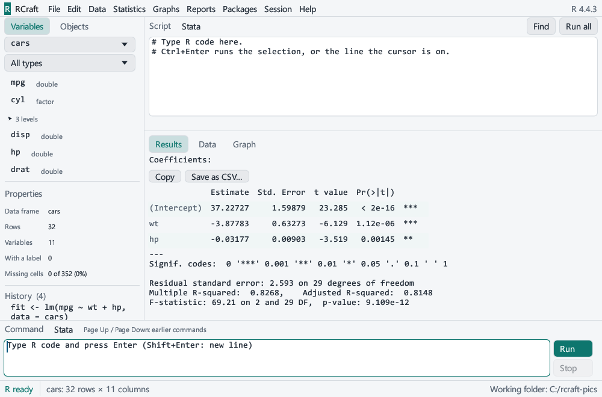

# Getting started

## R comes first

RCraft does not contain R. It drives an R you already have, as a separate program, and looks for it by itself in the usual places. The top right of the window shows the R version it found. If there is none, the window says so; install R, then start RCraft again.

Nothing RCraft shows is made up: every number comes from R, and every menu choice writes R code you can read, copy and run again.

## The panes

- **Left:** the Variables tab lists the columns of the data frame you are working on, and the Objects tab lists everything in the session, with a menu on each object. Below them are Properties and History. See [the Data tab and Properties](data-and-properties).
- **Top:** the Script editor, where you keep a longer script.
- **Middle:** the Results tab shows the commands and what they printed. The Data tab shows the data frame in a grid. The Graph tab shows the plots you have drawn.
- **Bottom:** the Command line, where you type R.

## Your first data file

1. Open the File menu and choose **Use my file**. Pick a file; RCraft shows a preview before it loads.
2. The data frame appears in Variables and in the Data tab. If you only want something to practise on, choose **Example data** from the File menu instead.
3. Look at the data first: the Data tab shows the rows, and the Statistics menu has summaries.

## Your first model

1. Open the Statistics menu and choose **Linear models**, then **Linear model**.
2. Pick the outcome and the predictors from your columns. The dialog shows the R it will run before you run it.
3. Press **Run**. The model prints in Results, and the R code goes into the log and the session, so you can [save the session](projects-and-reporting) as a script afterwards.

Next: [the menus](menus) say what else is there, and [the Command window](command-window) is for typing R yourself.
