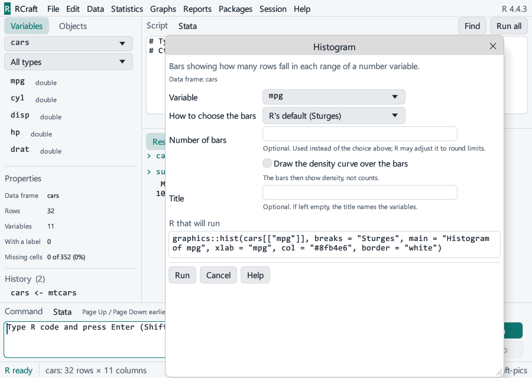
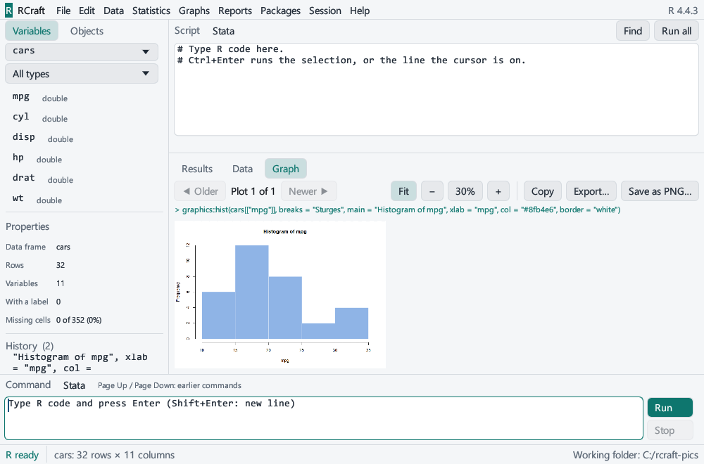

# The Graphs menu

The Graphs menu draws plots of the data frame shown in Variables. Its dialogs work like every other: choose the variables, read the R that will run, and press **Run**. They write base R graphics, so they need no package. Each has an optional **Title**; left empty, the title names the variables.

## One variable

- **Histogram**: bars counting the rows in each range of a number variable. Choose how the bars are set, or how many there are, and draw a density curve over them if you want.
- **Density plot**: a smooth curve of how a number variable's values are spread, one curve per group if you choose a group.
- **Box plot**: the median, quartiles and outliers, one box per group if you choose a group.
- **Bar chart**: a bar for each value of a categorical variable, as counts or percentages. Missing values are left out.
- **Normal Q-Q plot**: a number variable against a normal distribution; points near the line mean the values look normal. The Shapiro-Wilk test is under [Statistics](statistics-dialogs).

## Two variables

- **Scatter plot**: one point per row, with a straight-line (least squares) fit or a smooth (lowess) curve if you want them, coloured or split by a group.
- **Line plot**: a number variable joined by a line in the order of the horizontal variable, a time say, with a point at each row if you want.

Rows missing either value are left out of both.

## Several variables

- **Scatter plot matrix**: every pair of the chosen number variables, in one grid.
- **Heatmap**: a grid of coloured cells, either the correlation of each pair of variables (the number can be written in each cell) or each row's values, standardised. Alike variables can be put next to each other.

A plot of time series is under Statistics > Time series > **Time-series plot**.

## The Graph tab

A plot shows in the Graph tab, which opens by itself when one is drawn.

- **◀ Older** and **Newer ▶** step through the plots of the session.
- **Fit** fits the whole plot in the pane; **−** and **+** make it smaller and larger (so do Ctrl and the mouse wheel over the plot); the percentage shows it at its own size.
- **Copy** puts the plot on the clipboard as a picture, and **Save as PNG** writes it to a file.
- **Export** (also Graphs > **Export plot**) saves it as PNG, SVG or PDF, at a size and resolution you choose.

To put a plot in the session's report, see [projects and reporting](projects-and-reporting).
