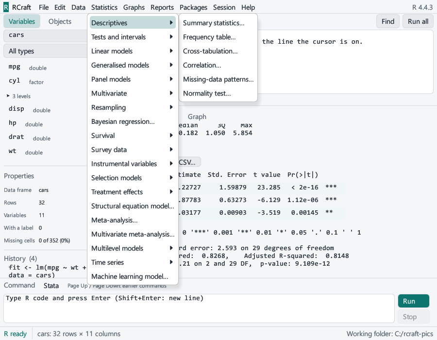
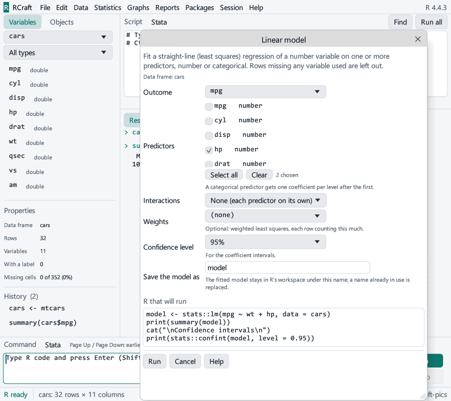

# The Statistics menu

The Statistics menu holds the summaries, tests and models. Like the [Data menu](data-dialogs), each entry opens a dialog on the data frame shown in Variables, shows the R it will run, and runs nothing until you press **Run**. What R prints goes into Results; a table there has **Copy** and **Save as CSV** buttons.

A model dialog has a **Save the model as** box (`model` for a linear model): the fitted model stays in R's workspace under that name, and a name already in use is replaced. Rows missing any variable a model uses are left out.

Some dialogs need an R package, which the dialog names, for example MASS for the negative binomial and ordinal models, plm for panel models, survey for survey data, lme4 for mixed models and metafor for meta-analysis. If it is not installed, the dialog offers to install it, and waits for your yes; see [Packages](packages).

## Descriptives

- **Summary statistics**: count, missing values, mean, standard deviation, minimum, quartiles and maximum, all together or split by a group.
- **Frequency table**: how many rows have each value, and what share that is.
- **Cross-tabulation**: counts for every pair of values of two variables, with shares and a chi-squared test if you want them.
- **Correlation**: how strongly pairs of number variables move together, with the number of rows each pair used.
- **Missing-data patterns**: how many values are missing in each variable, and which tend to be missing together.
- **Normality test**: the Shapiro-Wilk test of whether a number variable looks normal.

## Tests and intervals

One-sample, two-sample and paired t-tests; a test of proportions and the exact binomial test; Fisher's exact test; the Mann-Whitney, Wilcoxon signed-rank and Kruskal-Wallis tests, which compare by ranks; a test of equal variances; and agreement and reliability: Cohen's kappa for two raters, Fleiss' kappa for several, and intraclass correlations.

## Linear and generalised models

- **Linear models**: the linear model (least squares regression), one-way ANOVA with Tukey comparisons if you want them, and factorial ANOVA.
- **Generalised models**: logistic (a yes/no outcome), Poisson and negative binomial (counts), ordinal (ordered categories) and multinomial (unordered categories) models.

## More models

- **Panel models**: fixed-effects regression, and fixed-effects count or binary models; the classic panel estimators (within, random effects, between, pooled, first differences); the Hausman test; the dynamic panel model (GMM); panel instrumental variables; panel unit-root and serial-correlation tests.
- **Multivariate**: principal components, factor analysis, cluster analysis and discriminant analysis.
- **Resampling**: the bootstrap and permutation tests.
- **Bayesian regression**: a regression fitted by sampling its posterior (rstanarm).
- **Survival**: Kaplan-Meier curves, the log-rank test, the Cox model and the curves it predicts, the competing-risks model and parametric survival models.
- **Survey data**: means and totals, proportions and tables, ratios, quantiles and regression, with standard errors from the survey's design.
- **Instrumental variables**: two-stage least squares, and IV probit or tobit.
- **Selection models**: the Heckman selection model.
- **Treatment effects**: the effect of a 0/1 treatment estimated from observational data.
- **Structural equation model**, **Meta-analysis** and **Multivariate meta-analysis**.
- **Multilevel models**: linear, and logistic or Poisson, mixed models (lme4), and mixed models with glmmTMB.
- **Time series**: ARIMA models, autocorrelations, the unit-root test, exponential smoothing, vector autoregression and the time-series plot.
- **Machine learning model**: split the rows into training and test sets, fit a model with tidymodels, and score it on the test rows.

## After a model

Right-click a fitted model in the Objects tab and open its **Model** menu. It offers what works for that kind of model, such as **Model fit**, **Compare models**, **Predicted values and residuals**, **Model diagnostics**, **Diagnostic plots**, **Robust standard errors**, **Test terms**, **Average marginal effects**, **Sums of squares (Type II/III)** and **Custom contrasts**. A Bayesian model has its own (posterior predictions, trace plots and checks, comparison by loo), a time-series model has **Forecast**, and **Model table** puts models side by side in one table for a [report](projects-and-reporting).

Each dialog's Help button says what every choice means. For the R functions behind them, see R's own help, for example [lm](help:lm) or [glm](help:glm).
